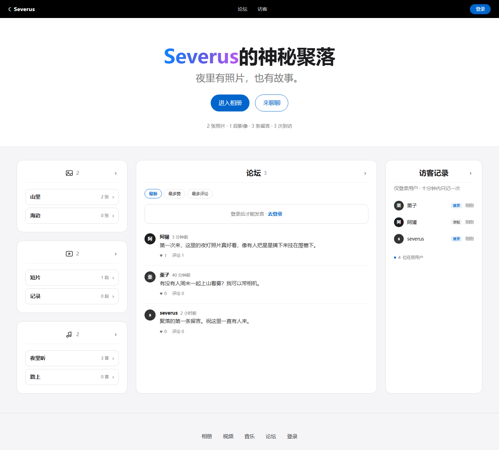

# Severus的神秘聚落

一个可以本地部署的完整网站：前端 + 后端 + 数据库，零第三方依赖，只跑 Python 标准库。

- **相册**——后台按文件夹传图，前台先进文件夹再看照片
- **视频**——后台按文件夹上传，前台点开居中播放，支持拖动
- **音乐**——后台按歌单上传；前台每首可下载、可置顶（管理员）；首页有迷你播放条，离开歌单页仍继续放
- **论坛**——登录后发帖；每页 10 条翻页；可点赞（一人一票）、可评论（倒序）；支持按最新/最多赞/最多评论排序
- **访客记录**——只记录登录用户；最多 10 条、**一人只显示最新一条**；
  **管理员不出现**在访客记录里
- **后台**——侧边栏 + 概览双栏（数字 / 快捷操作 / 存储 / 7 日趋势 / 系统）+
  媒体页左右分栏（左边上传、右边内容，相册面板撑满一屏）；
  多文件上传队列；图片可**就地改标题**、**置顶**、**勾选批量删除**；
  论坛支持按内容/作者/时间段筛选；用户可搜索；所有管理动作进**操作日志**

界面按 `awesome-design-md/design-md/apple/DESIGN.md` 实现：浅色列表层 + 深色沉浸层，
标题用 D 型渐变（只有 `Severus` 上色，中文保持实色）。



## 快速开始

```powershell
cd severus
powershell -NoProfile -ExecutionPolicy Bypass -File .\run.ps1
```

`run.ps1` 会自动：优先用 80 端口（被占用退到 8080）→ 监听 `0.0.0.0` →
打印本机和局域网地址。只想本机访问加 `-Local`。

没有装任何东西也能跑，因为**不需要 pip 安装**。

## 首次启动

程序会自动创建管理员账号，并把密码打印在控制台、同时写入 `data/ADMIN.txt`：

```
 初始管理员账号已创建
   用户名： admin（登录时不区分大小写）
   密  码： 类似 krwd4qxphwzu 的随机串
```

登录后到「后台 → 用户 → 修改我的密码」改成自己的，然后可以删掉 `ADMIN.txt`。
这个文件里是明文密码，别留在公开的地方。

**密码打错了、抄错了、或者压根没记下来**，不用重装，直接重置：

```powershell
python reset_admin.py                  # 生成一个新的随机密码
python reset_admin.py 我的新密码        # 指定一个自己记得住的
python reset_admin.py --check 某个密码  # 只验证对不对，不改动
```

重置后会同步更新 `data/ADMIN.txt`。

> 用户名登录和注册都**不区分大小写**：`admin`、`Admin`、`ADMIN` 是同一个账号，
> 注册时也不能用只差大小写的名字重复注册。

## 权限矩阵

| 操作 | 游客 | 普通用户 | 管理员 |
|---|---|---|---|
| 浏览相册 / 视频 / 帖子 | ✅ | ✅ | ✅ |
| 注册 / 登录 | ✅ | — | — |
| 发帖 | ❌ | ✅ | ✅ |
| 被记入访客记录 | ❌ | ✅ | ✅ |
| 上传 / 删除图片视频 | ❌ | ❌ | ✅ |
| 删帖 / 封禁用户 | ❌ | ❌ | ✅ |

## 目录

```
severus/
├─ server.py            HTTP 服务：路由、静态文件、上传、Range 分段
├─ store.py             SQLite 封装（表结构 + 查询）
├─ auth.py              scrypt 口令、HMAC 会话、内存限流
├─ selftest.py          端到端自检，85 个断言
├─ reset_admin.py       重置 / 验证管理员密码
├─ AGENTS.md            样式硬性约定（改样式前必读）
├─ run.ps1              启动器
├─ static/
│  ├─ section.html       分栏页（模块右上角 › 跳到这里）
│  ├─ index.html        首页
│  ├─ login.html        登录 / 注册
│  ├─ admin.html        后台
│  ├─ css/app.css       全部样式（Apple 规范落地）
│  └─ js/{app,login,admin,section}.js
├─ scripts/lan-firewall.ps1   按网段放行防火墙
├─ design/              设计过程稿（三种配色 + 渐变对照）
├─ screenshots/         实机截图
└─ （数据默认在 E:\Severus，可用 -DataDir 改）
```

## 几个技术决定

**为什么零依赖。** 这台机器 pip 装不上任何包。改用标准库后，用户不用配环境，
而且我能在这里把整条链路真正跑通、而不是写完就交。

**上传为什么不用 multipart。** Python 3.13 移除了 `cgi` 模块，手写 multipart 解析
又容易在二进制边界上出错。所以前端直接把文件字节当请求体发，元数据走 query string：

```
POST /api/admin/upload/video?title=夜航
Content-Type: application/octet-stream
<原始字节>
```

服务端边收边写临时文件，500MB 的视频也不会占内存，收完再校验文件头。

**视频拖动。** `/media/videos/*` 支持 `Range` 请求，返回 `206 Partial Content`，
所以进度条能正常拖。测试里专门验证了分段的字节内容。

**会话。** 无状态：`<uid>.<过期时间>.<HMAC 签名>`，HttpOnly + SameSite=Lax。
服务端不存会话表，登出即删 cookie，12 小时过期。

**CSRF。** 所有写操作要求 `X-Requested-With: fetch` 请求头。浏览器跨站表单
无法设置自定义头，天然挡掉。

**安全细节。** 口令用 `scrypt`（n=2^14）；上传文件用随机文件名 + 文件头嗅探
（伪装成 jpg 的 html/php 会被 415 拒绝）；媒体路径拒绝 `..`；用户输入全部走
`textContent`，不拼进 innerHTML。

## 可调参数

都在 `server.py` 顶部：

```python
PHOTO_MAX = 10 * 1024 * 1024    # 单张图片上限 10 MB
VIDEO_MAX = 500 * 1024 * 1024   # 单个视频上限 500 MB
TRACK_MAX = 50 * 1024 * 1024    # 单首音乐上限 50 MB
POST_MAX  = 500                 # 帖子字数上限
```

发帖频率限制（同一用户 20 秒 1 条）在 `api_create_post` 里；
登录/注册的 IP 限流在 `api_login` / `api_register` 里。

## 自检

```powershell
cd severus
python selftest.py
```

它会在临时目录里造一份独立数据、起一个真服务，把 85 项断言跑一遍：
页面、注册、登录、发帖、访客记录、上传、伪造文件拒绝、Range 分段、
路径穿越、删除、改密、封禁、CSRF、用户名大小写、改标题、置顶、批量删除、
存储统计、7 日趋势、操作日志、帖子与用户筛选、音乐上传与 Range、分栏页、文件夹/歌单（建夹、改名、置顶、删除转未分类、拖动移动）、点赞与评论、歌曲置顶、分片上传、歌单打包下载。**不碰你正式的 `data/`。**

## 数据与备份

默认放在 **`E:\Severus`**（`run.ps1` 自动判断：有 E 盘就用它，没有才退回项目内的 `data/`）。
想换位置：`.\run.ps1 -DataDir D:\mydata`，或设环境变量 `SEVERUS_DATA`。

- `severus.db` —— 用户、帖子、活动、媒体元数据
- `media\photos`、`media\videos`、`media\tracks` —— 原始文件
- `secret.key` —— 会话签名密钥（删了所有人掉线，密码不受影响）
- `ADMIN.txt` —— 初始管理员密码，改完可删

备份直接拷整个数据目录即可。数据库开了 WAL，
热备份时把 `severus.db-wal` 一起拷走。

## 局域网访问

手机要访问，两个条件：

1. 服务监听 `0.0.0.0`（`run.ps1` 默认就是这么启动的）
2. 防火墙放行。首次启动 Windows 会弹窗，必须点允许；没弹窗就跑：

```powershell
# 管理员 PowerShell
powershell -ExecutionPolicy Bypass -File .\scripts\lan-firewall.ps1 -Port 80
```

校园网通常有客户端隔离，最稳的还是电脑开热点，手机连热点后访问
`http://192.168.137.1`。

## 已知边界

- 单机 SQLite，适合几个人的小站；并发写入多了要换 PostgreSQL
- 没有邮件找回密码，忘了只能让管理员在数据库里改
- 视频格式只校验容器头（MP4 / WebM），编码是否浏览器能放由客户端决定
- 上传不支持断点续传，大文件中断要重传

## 设计说明

**所有样式只能取自 Apple 规范**——这条是硬性约定，写在 [AGENTS.md](AGENTS.md)，
改任何颜色/字号前先读它。

配色、字号、圆角、间距全部来自 Apple 规范里的 token，没有自创数值：

- 浅色层：`parchment #f5f5f7` 画布 + 白卡片 + `1px #e0e0e0` 细线
- 深色层：纯黑 `#000`（灯箱、播放器）
- 强调色只有一个：`#0066cc`，暗底用 `#2997ff`
- 标题 56/600/`-0.28px`，正文 17px/1.47
- 全集唯一一道阴影只给照片和视频封面，卡片按钮都不加

**导航栏有一处刻意的偏离**：规范里 `nav-link` 是 12px，那是给苹果那种
「商品页次要导航」用的；这里的导航是主要入口，而且中文在 12px 下笔画会糊，
所以放大到 14px、条高 52px，其余（纯黑底、无圆角、等宽间距）不变。

**页脚**：栏目整体居中，但每列内部左对齐；「后台」这一栏只对管理员渲染，
普通用户和游客看不到。

`design/` 里留了过程稿：`mock-dark.html`（夜航）、`mock-light.html`（白墙）、
`mock-type.html`（渐变字四种方案），可以直接在浏览器打开对比。

---

## 部署

**这是动态网站**，不是静态页面。前端是原生 HTML/CSS/JS（无构建、无框架），但数据存在服务端 SQLite，登录、发帖、上传、点赞都由 Python 进程处理。所以不能放到 GitHub Pages / Netlify 这类纯静态托管，需要一台能常驻 Python 进程的机器。

依赖只有一个：**Python 3.9+**，无第三方包。

### A. 局域网（默认场景）

```powershell
powershell -NoProfile -ExecutionPolicy Bypass -File .\run.ps1
```

放行防火墙后，同网段的手机/平板访问 `http://<这台电脑的IP>:8080`：

```powershell
New-NetFirewallRule -DisplayName "Severus 8080" -Direction Inbound -Protocol TCP -LocalPort 8080 -Action Allow
```

### B. 有公网 IP 的服务器 / VPS（推荐 Linux）

```bash
# 1. 系统依赖
sudo apt update && sudo apt install -y python3 nginx

# 2. 放代码与数据
sudo mkdir -p /opt/severus /var/lib/severus
sudo cp -r ./* /opt/severus/
sudo useradd -r -s /usr/sbin/nologin severus || true
sudo chown -R severus:severus /opt/severus /var/lib/severus

# 3. systemd 服务
sudo tee /etc/systemd/system/severus.service > /dev/null <<'EOF'
[Unit]
Description=Severus
After=network.target

[Service]
Type=simple
User=severus
WorkingDirectory=/opt/severus
Environment=SEVERUS_DATA=/var/lib/severus
ExecStart=/usr/bin/python3 server.py --host 127.0.0.1 --port 8080
Restart=always
RestartSec=3

[Install]
WantedBy=multi-user.target
EOF

sudo systemctl daemon-reload
sudo systemctl enable --now severus
sudo journalctl -u severus -f      # 首次启动会打印 admin 初始密码
```

Nginx 反代（`/etc/nginx/sites-available/severus`）：

```nginx
server {
    listen 80;
    server_name your-domain.com;

    client_max_body_size 1600m;          # 视频上限 1.5G
    proxy_request_buffering off;         # 分片直传，不落磁盘
    proxy_read_timeout 3600s;

    location / {
        proxy_pass http://127.0.0.1:8080;
        proxy_set_header Host $host;
        proxy_set_header X-Real-IP $remote_addr;
    }
}
```

```bash
sudo ln -s /etc/nginx/sites-available/severus /etc/nginx/sites-enabled/
sudo nginx -t && sudo systemctl reload nginx
sudo apt install -y certbot python3-certbot-nginx
sudo certbot --nginx -d your-domain.com      # 自动配 HTTPS
```

### C. 没有公网 IP

用 Cloudflare Tunnel（免费、不要公网 IP、自带 HTTPS）：

```bash
cloudflared tunnel --url http://127.0.0.1:8080
```

或 Tailscale / ZeroTier 组虚拟局域网，只给自己人访问。

### Windows 常驻

不想每次开终端，用任务计划程序：

```powershell
$act = New-ScheduledTaskAction -Execute "python" -Argument "server.py --host 0.0.0.0 --port 8080" -WorkingDirectory "C:\path\to\severus"
$trg = New-ScheduledTaskTrigger -AtStartup
Register-ScheduledTask -TaskName "Severus" -Action $act -Trigger $trg -RunLevel Highest -User "SYSTEM"
```

### 上线前务必

- 改掉初始 admin 密码（`python reset_admin.py 新密码`）
- 开 HTTPS，否则密码是明文传输
- `data/` 目录定期备份（数据库 + 所有媒体文件都在里面）
- 不要用 root 跑服务
